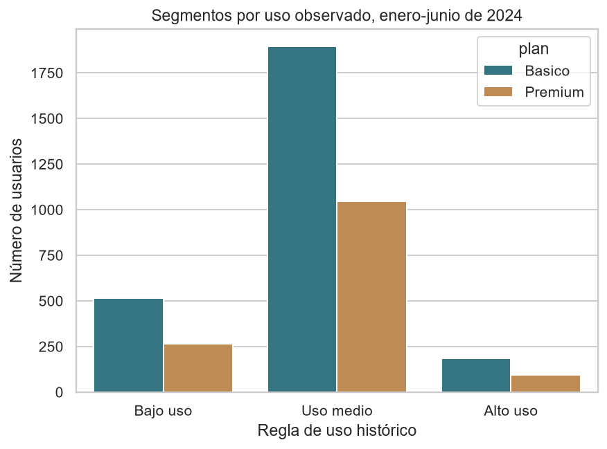

# ConnectaTel: uso móvil y segmentación de clientes

Proyecto educativo de **José Luis Ronquillo Quintanar**, realizado en el Sprint 7 de TripleTen con asistencia de IA. Integra tres fuentes para describir llamadas y mensajes, revisar la calidad de datos y proponer oportunidades comerciales.

## Hallazgos

- **4,000 usuarios** y **39,950 eventos fechados**, del 1 de enero al 30 de junio de 2024. Los 50 eventos sin fecha se conservan fuera del análisis temporal.
- **22,068 mensajes, 17,882 llamadas y 91,212.18 minutos** registrados.
- **781 usuarios de bajo uso (19.525%), 2,941 de uso medio (73.525%) y 278 de alto uso (6.95%)**, según las reglas del curso. Son grupos del periodo completo, no niveles mensuales del plan.
- **157 usuarios** con al menos una métrica de uso señalada por IQR. No se interpreta esa señal como prueba de fraude.
- **10,451 eventos anteriores al alta registrada**, asociados a 1,302 usuarios. Esta inconsistencia limita las decisiones sobre antigüedad, retención y exposición.

Los promedios de mensajes por usuario son muy próximos entre planes: 5.519 en Básico y 5.514 en Premium. En minutos, son 22.55 y 23.26, respectivamente. Son comparaciones descriptivas, no efectos causales del plan.

## Calidad y decisiones

Se conservan los originales y se registran 55 edades imputadas con la mediana válida de 48 años, 565 ciudades sin determinar, 40 altas posteriores al corte de 2024 y 466 fechas de baja con formato no documentado. Se señalan 16 mensajes con duración y 12 llamadas con longitud; los minutos se suman solo en llamadas.

Los ausentes estructurales se mantienen. No se rellena con ceros la duración de mensajes ni la longitud de llamadas. Las edades imputadas se separan en una clasificación adicional para decisiones de negocio.

[Inferencia] La agrupación por país deriva de las ciudades; no confirma nacionalidad ni ubicación. Se conserva la categoría «Sin determinar».

El consumo mensual se compara con los beneficios mensuales del catálogo. Se observan nueve meses de usuario con exceso de minutos en Básico; no se estima facturación completa porque faltan consumo de GB, cobertura de la extracción e historial de planes. Los meses sin eventos no se consideran automáticamente meses activos con consumo cero.

## Contenido

- `ConnectaTel_analisis.ipynb`: notebook con 43 celdas de código, tablas, siete gráficas, decisiones y comprobaciones.
- `results_aggregate.json`: resultados agregados y métricas de auditoría.
- `requirements.txt`: bibliotecas para ejecutar el análisis.
- `segmentos_uso.png`: vista de la distribución por nivel de uso. Las siete gráficas están incluidas en el notebook.

Las salidas que mostraban registros individuales se omiten de la versión pública. Los CSV, nombres e identificadores de usuarios no se publican.

## Reproducción

1. Descarga los tres CSV desde tu acceso autorizado a TripleTen: `plans.csv`, `users_latam.csv` y `usage.csv`.
2. Colócalos en una carpeta `data/` junto al notebook. En el entorno del curso se utiliza `/datasets/`.
3. Instala las bibliotecas con `pip install -r requirements.txt`.
4. Abre el notebook, reinicia el entorno y ejecuta las celdas en orden.

El notebook ya incluye resultados agregados para lectura. Para recalcular desde el origen necesitas los CSV autorizados. Las comprobaciones validan las claves, la conservación de los 4,000 usuarios, la conciliación de eventos y los límites de segmentación.

## Propuestas y límites

Evaluar una oferta flexible para el grupo de bajo uso y estudiar las necesidades del grupo de alto uso. Antes de sugerir migraciones individuales, resolver la coherencia temporal y verificar que la extracción representa el consumo completo.

No se afirma que un segmento sea más rentable: faltan costos, ingresos efectivos y datos móviles. El análisis abarca seis meses de actividad, no un año completo. Incluir los eventos sin fecha cambia de segmento a dos usuarios.

Fuente: datasets y plantilla del proyecto ConnectaTel de TripleTen, consultados el 31 de octubre de 2026. La documentación pública resume el trabajo y sus límites; no reproduce los materiales completos del curso.
